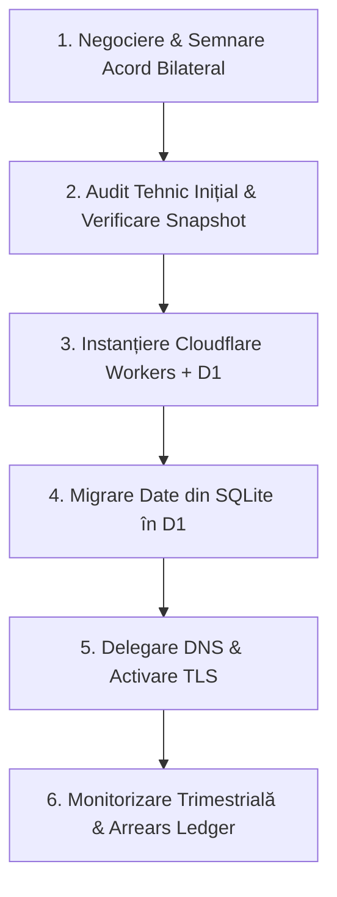

# Procedura Oficială de Predare Către un Operator Comercial (Handover Runbook)

Data: 24 Octombrie 2026  
Versiune: **GENESIS v3.2**  
Statut: **RUNBOOK DE TRANSFER ȘI GUVERNANȚĂ COMERCIALĂ**  

---

## 1. Condiții Prealabile Obligatorii de Eligibilitate

Pentru a prelua exploatarea comercială a rețelei oficiale STUPUL, orice entitate comercială (Operator) trebuie să îndeplinească cumulativ următoarele criterii de calificare:

1. **Personalitate Juridică și Conformitate Fiscală**: Entitatea trebuie să fie o societate comercială legal constituită, cu cod de identificare fiscală valid și fără sancțiuni internaționale (OFAC / UE).
2. **Acceptarea Integrității Plăților (Cele 8 Porți de Eligibilitate)**:
   - Acceptarea destinației exclusive de decontare a redevenței: **USDC pe rețeaua BASE** la adresa `0xC6F86e170411182114FcCdb28793dC76B5e8D144` (sau cont fiduciar convenit);
   - Interdicția absolută a sistemelor de plată opace sau care deduc cheltuieli de regie neautorizate.
3. **Asumarea Redevenței Pasive de 5%**: Acceptarea expresă a ratei de 500 basis points (5.00%) aplicată asupra tuturor încasărilor eligibile brute.

---

## 2. Etapele Protocolului de Predare (Step-by-Step Handover)

### Pasul 1: Semnarea Bilaterală a Acordului de Licență Comercială
- Semnarea acordului de licență comercială de către reprezentanții legali autorizați ai ambelor părți prin semnătură electronică calificată.
- Înregistrarea identificatorului fiscal al operatorului în registrul de guvernanță.

### Pasul 2: Configurarea Infrastructurii de Margine (Edge Cloud)
- Crearea unui cont Cloudflare dedicat operatorului;
- Inițializarea bazei de date Cloudflare D1 folosind schema din `packages/server/src/storageAdapter.ts`;
- Configurarea cheilor de criptare pentru WebAuthn RP ID pe domeniul public de producție.

### Pasul 3: Migrarea Tranzacțională a Stării Lumii
- Exportul stării curente a civilizației prin snapshot semnat SHA-256;
- Validarea hash-ului de integritate (`validateAndImportSnapshot`);
- Popularea inițială a tabelelor `state`, `commands` și `events` în Cloudflare D1.

### Pasul 4: Activarea Ciclului Financiar Lunar și a Auditului
- În primele 5 zile ale fiecărei luni calendaristice, operatorul generează raportul financiar pe baza încasărilor brute (`calculateRoyaltiesExactBps`);
- Emiterea facturii corespunzătoare în Registrul de Arierate (`RoyaltyArrearsLedger`);
- Efectuarea transferului de 5% în termen de maximum 30 de zile.
- Dacă plata întârzie peste 60 de zile, licența comercială este suspendată de drept conform contractului.
